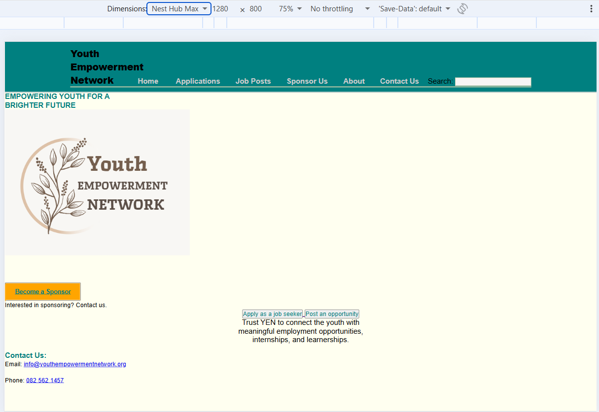
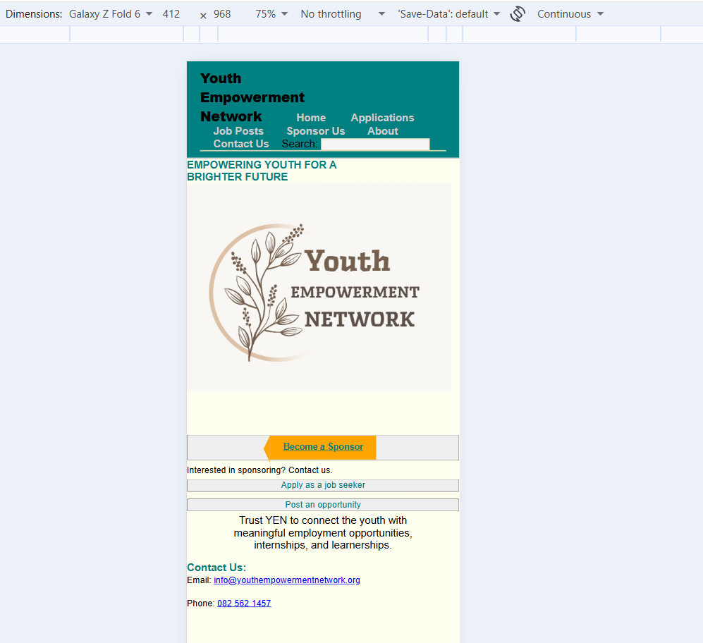
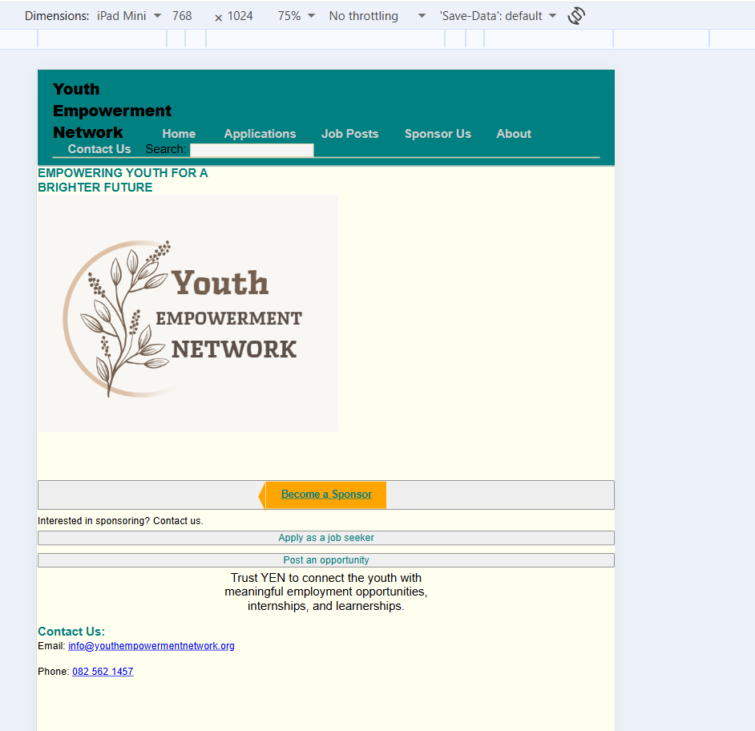

## Part 2 Updates

## Part 3 Updates
For 3.1
1. Added proper title tags to each page and also the meta descriptions
2. Header tags already exist and already have descriptive file names and alt text for images
3. URLs and links are also fine. Mobile friendliness was included too on the css

For 3.2
Backlinks:  The website could gain backlinks from employment organizations and partner companies.
Social Media:  I added an Instagram on where to hear more about the organization
1. Added the local SEO paragraph on the about page

